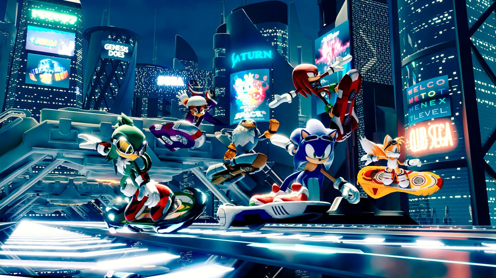
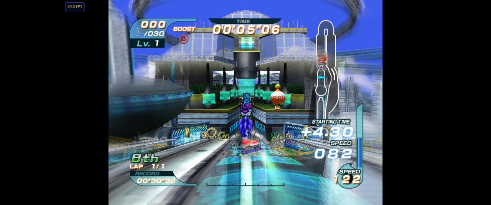
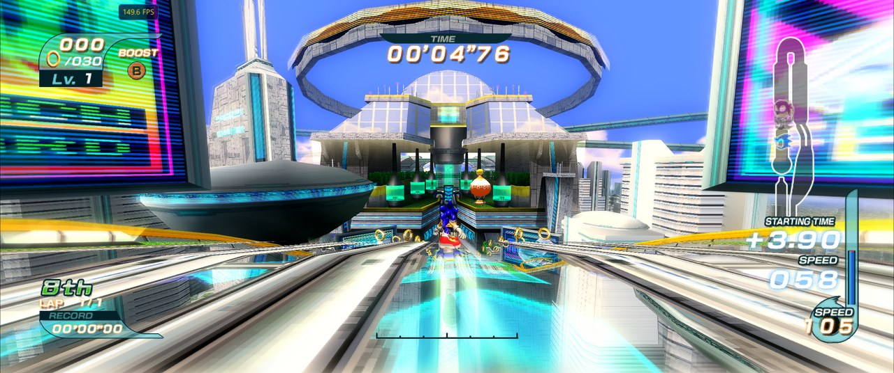
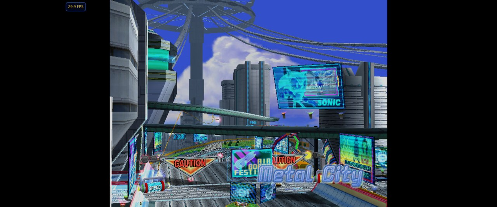
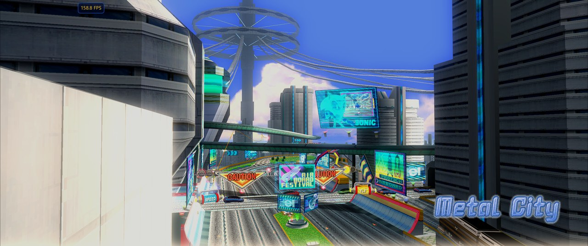
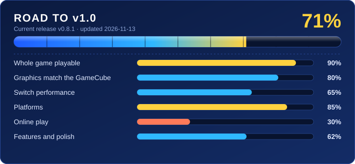

> **Alpha testers needed:** [Sonic Heroes native port](https://github.com/teclilla18/sonic-heroes-recomp)

  

# Sonic Riders native port

Play **Sonic Riders** (GameCube, USA) natively, with no emulator, on a modded **Nintendo Switch**, a
**Windows PC**, an **Android phone**, **Linux / Steam Deck** (new, untested on a Deck), or an **iPhone / iPad** (new, built on a Mac). The game is rebuilt on your own PC from **your own disc image**; this project contains
no game files.

**Original** (4:3)

**This port** (PC, 21:9)

**Original** (4:3)

**This port** (PC, 21:9)

> [!IMPORTANT]
> **Switch:** no overclock needed for a steady 30 fps: at stock clocks races run at 30 fps, and
> the *60 fps* setting gives 60 in lighter parts of a race and 30 in the busiest ones. A steady 60 still
> needs an overclock (tested at CPU 1785 MHz / GPU 1152 MHz / memory 2133 MHz on an OLED; overclock at
> your own risk).

## Get it

| I want to play on... | Download from the [latest release](../../releases/latest) | Guide |
|---|---|---|
| a **Windows PC** | `SonicRiders-PC-Setup-<version>.zip` | [Install on PC](docs/INSTALL.md#install-on-pc) |
| a modded **Nintendo Switch** | `SonicRiders-Switch-Setup-<version>.zip` | [Install on Switch](docs/INSTALL.md#install-on-switch) |
| an **Android phone** (64-bit, Android 11+) | `SonicRiders-Android-Setup-<version>.zip` | [Install on Android](docs/INSTALL.md#install-on-android) |
| **Linux** or a **Steam Deck** (new, test version) | `SonicRiders-Linux-Setup-<version>.zip` from the [Linux test pre-release](../../releases/tag/v0.5.0-linux-test) | [Install on Linux / Steam Deck](docs/INSTALL.md#install-on-linux--steam-deck) |
| an **iPhone** or **iPad** (new; built on a Mac) | `SonicRiders-iOS-Setup-<version>.zip` | [Install on iPhone / iPad](docs/INSTALL.md#install-on-iphone--ipad) |

**In short:** extract the zip, double-click the `Install Sonic Riders` file, pick your disc image, and
wait 10–30 minutes the first time (Android: 20–40, then it installs over a USB cable). Every version is
built on a Windows 10/11 PC, except Linux / Steam Deck, which builds on the Linux machine itself
(no compiler or root rights needed), and iPhone / iPad, which builds on a Mac with Xcode.

**You need:** your own **Sonic Riders (USA)** disc image (`GXEE8P`, a full 1.4 GB `.iso`) and a
64-bit Windows 10 (1803+) or 11 PC with internet the first time. Switch: custom firmware with the
Homebrew Menu. PC: a graphics card with OpenGL 3.3. Android: USB debugging turned on, about 2 GB free on
the phone. [All requirements](docs/INSTALL.md#what-you-need)

## Playing

| | Switch | PC keyboard | PC gamepad |
|---|---|---|---|
| Move | Left stick | W A S D | Left stick |
| A / B / X / Y | A / B / X / Y | J / K / L / I | A / B / X / Y |
| START | + | Enter | Start |
| Settings menu | hold − | hold F1 | hold Back |

Android: touch controls on screen (top-left button = settings menu) or any controller. Up to 4 players on
Switch and PC, 2 on one phone: connect more controllers. [Full controls, settings and multiplayer](docs/PLAYING.md)

## Status

<b>What v1.0 means, and what each bar still needs</b>

v1.0 = the whole game plays like the GameCube original on every supported platform, Switch races hold their
frame rate, and you can race friends online. The overall number is a weighted average (game 25 %, the
rest 15 % each), judged by hand at each release; `tools/make_progress.py` draws the card.

| Area | Done | Left for v1.0 |
|---|---|---|
| Whole game playable | 90 % | Grand Prix freeze after character select (#18), rare "Now Loading" hang (#6) |
| Graphics match the GameCube | 80 % | Lens flare (#7), story cutscene monitor (#4), stronger speed blur (#3) |
| Switch performance | 70 % | 60 fps at stock clocks (#1), 3-4 player races at 60 with an overclock (#2) (done on main: heavy 1P views hold 60 at 1.5x with picture options, overclocked) |
| Platforms | 85 % | Linux / Steam Deck out of test, Switch Lite / original / docked reports (#9) |
| Online play | 30 % | Lockstep works on one PC; still to do: LAN and internet sessions, Switch-Switch, PC-Switch, a menu to join |
| Features and polish | 62 % | Custom music, right-stick camera, in-game updates, code mods (done on main: Lv. 4/5, gold capsule respawn, dash panels keep speed, menu details) |

Playable from boot to races, story mode and 4-player Free Race, with sound, on both platforms.

- **PC:** 60 fps on the test PC (RTX 3060), 4 players included.
- **Switch (stock clocks):** a steady 30 fps in races (1 player tested); 60 fps in lighter scenes with
  the *60 fps* setting.
- **Android (new in v0.4.0):** 60 fps races on a Galaxy S23 Ultra (other phones untested).
  **Screen recording is not supported on Android:** recording the screen during a race makes the phone's
  graphics driver reset the game again and again until it closes. Record with a capture card or play
  without recording.
- **iPhone / iPad (new):** 60 fps races on an iPhone 17 Pro, iPad Pro 11" (M1) and iPad (A16) (a short stutter
  the first time a new effect appears); the iPad 7th generation (2019) plays with small dips on busy tracks.
- **Switch (overclocked):** 1–2 players mostly 60 fps; 3 players mostly 60 with dips in the busiest
  moments; 4 players about 30 fps.
- Known issues are tracked in [Issues](../../issues); what changed in each version is in the
  [CHANGELOG](CHANGELOG.md).

## More

| | |
|---|---|
| [Installing, updating, troubleshooting](docs/INSTALL.md) | Requirements, step-by-step setup, fixes for common problems |
| [Playing](docs/PLAYING.md) | Controls, settings menu, multiplayer, debug options |
| [Reporting bugs](docs/REPORTING-BUGS.md) | What to include, logs, screenshots |
| [Modding](docs/MODDING.md) | Swapping characters, changing stats, custom tracks (PC, in progress) |
| [Building from source](docs/BUILDING.md) | For developers |
| [Contributing](CONTRIBUTING.md) | Help is welcome from players and developers; coding agents can use [CLAUDE.md](CLAUDE.md) |

## How it works

The game's PowerPC code (`main.dol` + `_Main.rel`) is translated to C ahead of time on your PC
(**static recompilation**), and the GameCube hardware (graphics, disc, audio, memory card,
controllers) is reimplemented natively: deko3d on the Switch, OpenGL 3.3 on PC. The approach follows
[SwitchWakerHD](https://github.com/centollOS/SwitchWakerHD) and
[ZeldaWWHDRecomp](https://github.com/ZeldaWWHDRecomp/ZeldaWWHDRecomp), whose PowerPC→C translator this
project forks. Current status is in [STATE.md](STATE.md); design notes in [docs/REFERENCE.md](docs/REFERENCE.md) and [docs/HISTORY.md](docs/HISTORY.md).

## Legal

- A fan project, **not affiliated with, endorsed or sponsored by SEGA or Nintendo**. "Sonic Riders"
  and "Nintendo Switch" are trademarks of their owners, used only to describe what this works with.
- **This repository and its releases contain no game code, assets, data or console keys.** You need
  your own disc image of Sonic Riders (USA), made from a disc you own. Everything derived from the
  game is generated locally on your PC by the setup tool.
- **Never share** your built `.nro`, `.exe` or `.nsp`, or your disc image. Issues and pull requests
  that contain game files are deleted.

Licensed under the [Mozilla Public License 2.0](LICENSE), like the ZeldaWWHDRecomp translator it
forks (`third_party/LICENSE-MPL-2.0`).

## Credits

- [SwitchWakerHD](https://github.com/centollOS/SwitchWakerHD) and
  [ZeldaWWHDRecomp](https://github.com/ZeldaWWHDRecomp/ZeldaWWHDRecomp): the approach, and the
  PowerPC→C translator this project forks (MPL-2.0).
- [Dolphin](https://dolphin-emu.org/): hardware documentation and behaviour reference (no Dolphin
  code is included).
- [decomp-toolkit](https://github.com/encounter/decomp-toolkit): analysis of the game's executables.
- [devkitPro](https://devkitpro.org/), [libnx](https://github.com/switchbrew/libnx) and
  [deko3d](https://github.com/devkitPro/deko3d): the Switch toolchain and graphics API.
- [nx-hbloader](https://github.com/switchbrew/nx-hbloader) (ISC) and
  [hacBrewPack](https://github.com/The-4n/hacBrewPack): the optional forwarder NSP.
- [SDL2](https://www.libsdl.org/) and [llvm-mingw](https://github.com/mstorsjo/llvm-mingw): the PC version.
- [Dear ImGui](https://github.com/ocornut/imgui) (MIT): the settings menu; its layout follows [SwitchWakerHD](https://github.com/centollOS/SwitchWakerHD)'s settings overlay.
- [AMD FidelityFX Super Resolution 1](https://github.com/GPUOpen-Effects/FidelityFX-FSR) (MIT): the
  sharpening and upscaling (EASU, RCAS), ported to GLSL in `runtime/src/platform/host/fsr1_gl.h` and
  `runtime/shaders/vk_easu.frag` / `vk_rcas.frag`.
- gamemasterplc's 16:9 Gecko code: the idea behind the widescreen option.
- Banner image: fan art by an unknown artist. If it's yours, open an issue and we'll credit you or remove it.
- Game icon (`setup/icon.png`): fan-made Sonic Riders icon by [cedry2kio](https://www.deviantart.com/cedry2kio) on
  DeviantArt, used with credit. cedry2kio, if you'd like it changed or removed, open an issue and we'll do it right away.

Sonic Riders is © SEGA. This project is not affiliated with SEGA.
