

  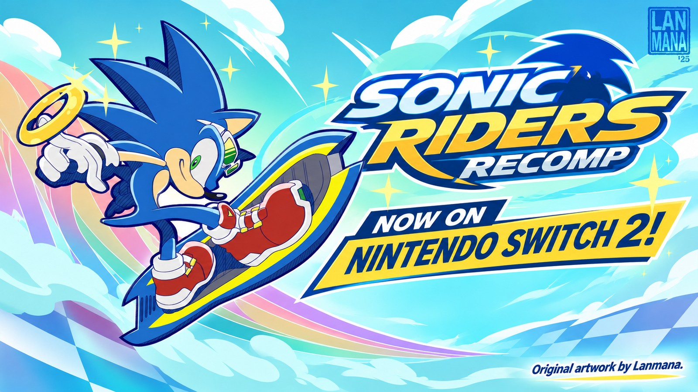

  <a href="#status">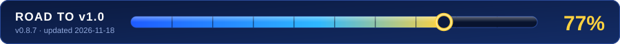</a>

<h3 align="center">Sonic Riders, running natively. No emulator. One of the first homebrew games playable on Nintendo Switch 2.</h3>

  Also on Nintendo Switch, Windows PC, Android, Linux / Steam Deck and iPhone / iPad.

  <a href="https://github.com/teclilla18/sonic-riders-recomp/releases/tag/v0.8.7-switch2-alpha.2"><b>🎮 Play on Switch 2 (Alpha)</b></a>
  &nbsp;·&nbsp;
  <a href="https://github.com/teclilla18/sonic-riders-recomp/releases/latest"><b>⬇️ Download for every other platform</b></a>
  &nbsp;·&nbsp;
  <a href="#get-it"><b>📖 Install guides</b></a>

  
  

  
  
  
  
  
  
  
   
  
  
  
  
  

> **🎉 Now playable on Nintendo Switch 2.** I've been working on running Sonic Riders natively on Switch 2 since
> Seedsow came out, and the alpha already runs several races in a row at 2x internal resolution with Riders Plus.
> Audio can still break up and there is some stuttering, so it's an alpha: please
> [report bugs](https://github.com/teclilla18/sonic-riders-recomp/issues/new?template=bug_report.yml). A huge thank
> you to the Switch 2 homebrew developers for making this possible.
> [What to expect](docs/SWITCH2-ALPHA.md)
>
> **🦔 New in v0.8.7:** Super Sonic joins Riders Plus (999 rings, Lv. 4/5, faster stats), with a better split-screen HUD.

## Riders Plus: break the limits

  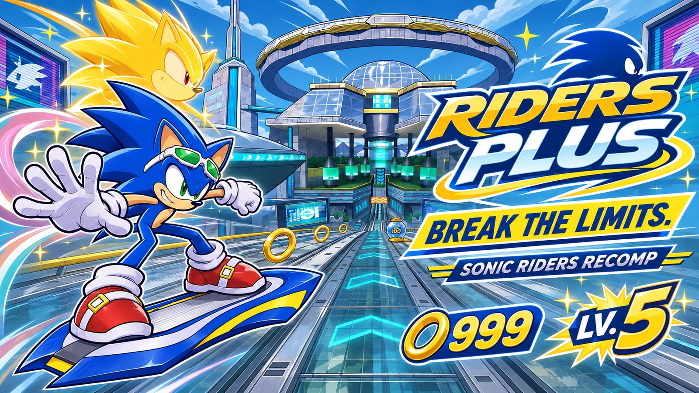

**Riders Plus** is our own take on the game's racing, built in and **on by default**. Same tracks, characters and
gear; the limits are what change. Turn it off any time in **Settings > Gameplay > Riders Plus** for the original rules.

| | Original game | Riders Plus |
|---|---|---|
| Ring limit | 100 | **999** (a hit or a fall still costs 100) |
| Gear levels | Lv. 1-3 | **Lv. 4 at 200 rings, Lv. 5 at 300** |
| Gold 100-ring capsule | Gone once taken | **Comes back after 25 seconds** |
| Dash panels | Set you to the panel's speed | **The panel's speed, or your speed + 25 km/h** |
| Speed Shoes | Set you to 200 km/h | **Your speed + 80 km/h** (at least 200) |
| Charging a jump | Slows you down at once | **Keeps your speed for 0.75 s** |

  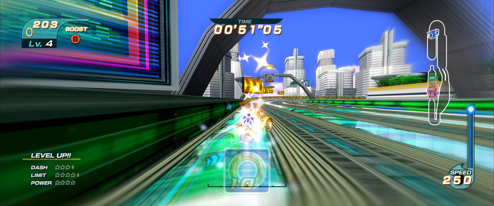
  
   
  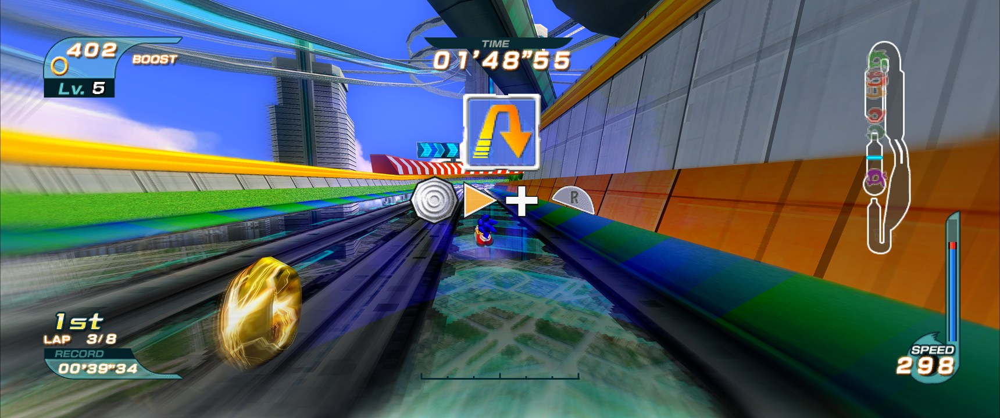
   
  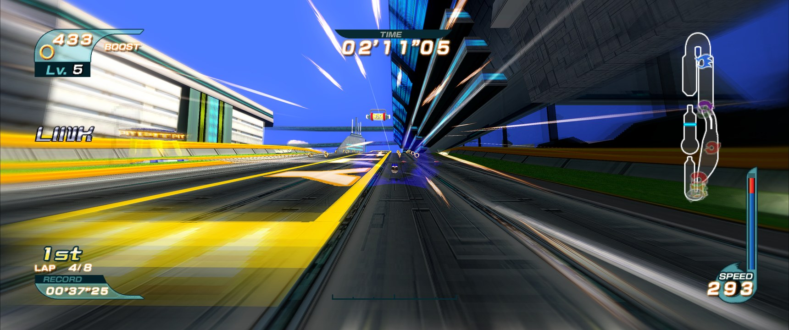
  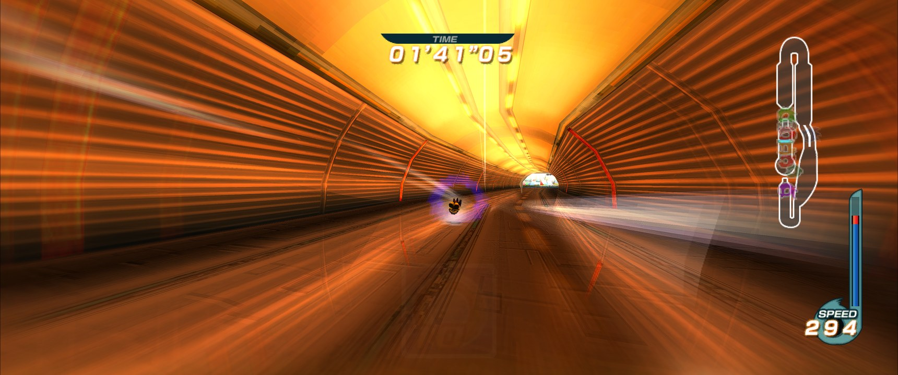
   LEVEL UP!! to Lv. 4 and Lv. 5, then 298 km/h with 402 rings. All shots: a real race on PC, 21:9

<b>How Lv. 4 and Lv. 5 work, with charts</b>

Collect 200 rings for Lv. 4 and 300 for Lv. 5. You get the game's own LEVEL UP!! (sparkle, sound and a full air
tank), and the HUD shows "Lv. 4" or "Lv. 5" in the game's own digits. Each gear keeps its own Lv. 1-3 stats and
builds on its Lv. 3 numbers. Sonic's Blue Star goes from 180 / 250 km/h (top speed / boost) at Lv. 3 to 200 / 275
at Lv. 4 and 215 / 300 at Lv. 5.

  
  
   
  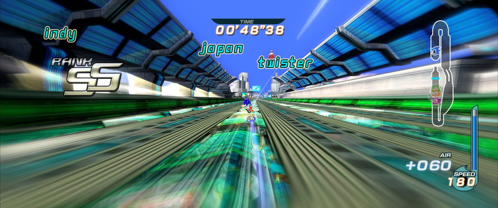

Next up: extra character slots for mod characters, custom music
([#17](https://github.com/teclilla18/sonic-riders-recomp/discussions/17)) and a right-stick camera.
[Share your ideas](https://github.com/teclilla18/sonic-riders-recomp/discussions).

## Original vs this port

| Original GameCube (4:3) | This port (PC, 21:9) |
|---|---|
| <a href="docs/images/compare/original-1.jpg">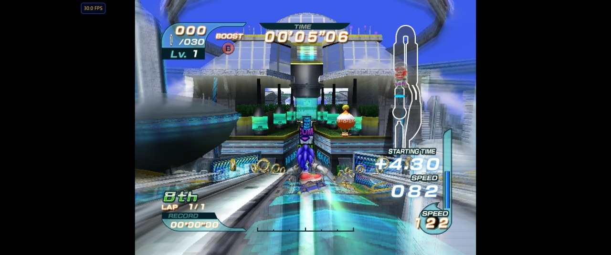</a> |  |
| <a href="docs/images/compare/original-2.jpg">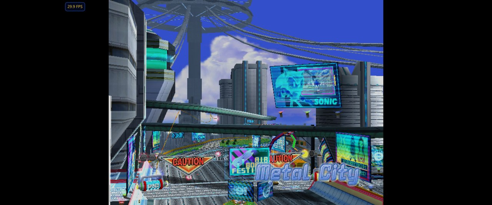</a> | <a href="docs/images/compare/recomp-2.jpg">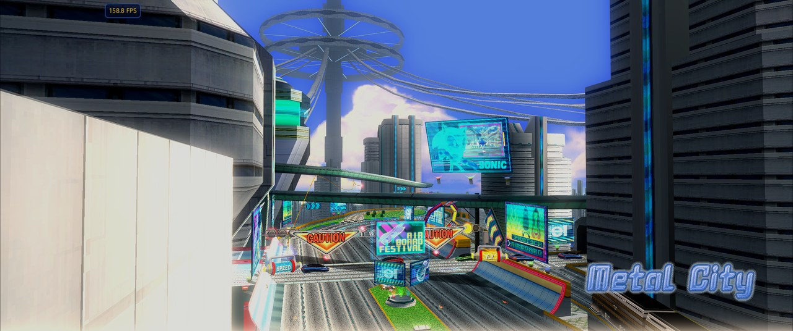</a> |

## Get it

**First time on a console?** Follow a picture booklet: small steps, real installer pictures, a checkpoint on every page.
Updating? Stable versions update with one press of **UPDATE NOW** in the app (the Switch 2 alpha updates by hand).

| I want to play on... | Download | Guide |
|---|---|---|
| **Nintendo Switch 2** (experimental alpha) | [Switch 2 Alpha 2](https://github.com/teclilla18/sonic-riders-recomp/releases/tag/v0.8.7-switch2-alpha.2) (separate pre-release) | [Picture booklet](https://teclilla18.github.io/sonic-riders-recomp/install-switch2.html) · [Alpha guide](docs/SWITCH2-ALPHA.md) |
| a modded **Nintendo Switch** / Lite / OLED | `SonicRiders-Switch-Setup-<version>.zip` from the [latest release](../../releases/latest) | [Picture booklet](https://teclilla18.github.io/sonic-riders-recomp/install-switch.html) · [Install on Switch](docs/INSTALL.md#install-on-switch) |
| a **Windows PC** | `SonicRiders-PC-Setup-<version>.zip` | [Install on PC](docs/INSTALL.md#install-on-pc) |
| an **Android phone** (64-bit, Android 11+) | `SonicRiders-Android-Setup-<version>.zip` | [Install on Android](docs/INSTALL.md#install-on-android) |
| **Linux** or a **Steam Deck** (test version) | `SonicRiders-Linux-Setup-<version>.zip` | [Install on Linux / Steam Deck](docs/INSTALL.md#install-on-linux--steam-deck) |
| an **iPhone** or **iPad** (built on a Mac) | `SonicRiders-iOS-Setup-<version>.zip` | [Install on iPhone / iPad](docs/INSTALL.md#install-on-iphone--ipad) |

Easy-read guides for every platform: [first install](https://claude.ai/artifact/4PSHvwKrxWKTqAp5tDCu6W) ·
[updating](https://claude.ai/artifact/FtNxFJFBdtLqmMFW7QjXFN).

**In short:** extract the zip, double-click `Install Sonic Riders`, pick your disc image, and wait 10-30 minutes
the first time. **You need** your own **Sonic Riders (USA)** disc image (`GXEE8P`, a full `.iso` or Dolphin's
`.rvz`) and a Windows 10/11 PC (Linux builds on the Linux machine, iPhone / iPad on a Mac). This project contains
no game files. [All requirements](docs/INSTALL.md#what-you-need)

## Playing

| | Switch | PC keyboard | PC gamepad |
|---|---|---|---|
| Move | Left stick | W A S D | Left stick |
| A / B / X / Y | A / B / X / Y | J / K / L / I | A / B / X / Y |
| START | + | Enter | Start |
| Settings menu | hold − | hold F1 | hold Back |

Android: touch controls (top-left button = settings menu) or any controller. Up to 4 players on Switch and PC,
2 on one phone. [Full controls, settings and multiplayer](docs/PLAYING.md)

<b>HD texture packs (PC and Switch)</b>

Texture packs made for **Dolphin** work as they are: `.png` or `.dds`, in a `.zip`, `.7z` or `.rar`, or already
unpacked. Download the pack yourself (we don't host packs), then:

- **PC:** open the launcher, **Mods** page, **Add texture pack...**, wait for **Installed**, press **PLAY**.
- **Switch:** in **Install Sonic Riders (Switch).exe**, under **4. Texture packs (optional)**, press
  **Add texture pack...**, then **BUILD AND INSTALL** (or **UPDATE NOW**).

Turn packs on or off and change their order on the **Mods** page (or in game: settings menu, **Mods**). On the
Switch, HD textures are shown at up to 512 x 512 and freeze briefly the first time each one appears.
Details and making your own: [docs/MODDING.md](docs/MODDING.md#texture-packs).

## Status

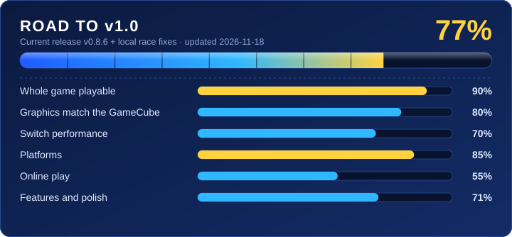

<b>What v1.0 means, what each bar still needs, and performance per platform</b>

v1.0 = the whole game plays like the GameCube original on every supported platform, Switch races hold their
frame rate, and you can race friends online. The overall number is a weighted average (game 25 %, the
rest 15 % each), judged by hand at each release; `tools/make_progress.py` draws the card.

| Area | Done | Left for v1.0 |
|---|---|---|
| Whole game playable | 90 % | Grand Prix freeze after character select (#18), rare "Now Loading" hang (#6) |
| Graphics match the GameCube | 80 % | Lens flare (#7), story cutscene monitor (#4), stronger speed blur (#3) |
| Switch performance | 70 % | 60 fps at stock clocks (#1), 3-4 player races at 60 with an overclock (#2) (done on main: heavy 1P views hold 60 at 1.5x with picture options, overclocked) |
| Platforms | 85 % | Android #32 resolved: Vulkan 1.1 race/clean quit confirmed on Mali; MoltenVK pending. Linux / Steam Deck out of test, Switch Lite / original / docked reports (#9) |
| Online play | 55 % | PC-PC, PC-Switch and Switch-Switch races stay in sync (tested over home networks); each player keeps their own screen shape; still to do: internet play (lobby server with room codes), a room-wide 30 fps switch for slow consoles, phones, 3-4 players, ping and delay settings |
| Features and polish | 72 % | Responsive installers, DPI/completion and output-folder action tested. Remaining: custom music, right-stick camera, code mods/new characters and background texture-pack loading on Switch. |

Playable from boot to races, story mode and 4-player Free Race, with sound.

- **PC:** 60 fps on the test PC (RTX 3060), 4 players included.
- **Switch (stock clocks):** a steady 30 fps in races; the *60 fps* setting gives 60 in lighter parts of a race.
  **Overclocked** (CPU 1785 / GPU 1152 / memory 2133 MHz, at your own risk): 1-2 players mostly 60 fps, 3 players
  mostly 60 with dips, 4 players about 30.
- **Android:** 60 fps races on a Galaxy S23 Ultra. Screen recording during a race is not supported (the phone's
  graphics driver keeps resetting the game); use a capture card.
- **iPhone / iPad:** 60 fps races on an iPhone 17 Pro, iPad Pro 11" (M1) and iPad (A16); the iPad 7th generation
  (2019) has small dips on busy tracks.

Known issues: [Issues](../../issues). What changed in each version: [CHANGELOG](CHANGELOG.md).

## Community

- **Vote on what comes next:** online play or custom characters and stages ([poll](https://github.com/teclilla18/sonic-riders-recomp/discussions/26)).
- **Alpha testers wanted** for the [Sonic Heroes native port](https://github.com/teclilla18/sonic-heroes-recomp).
- ☕ Enjoying the port? [Support it on Ko-fi](https://ko-fi.com/teclilla18). Donations are optional and grant no
  rights to any Sonic Riders intellectual property.

| More | |
|---|---|
| [Installing, updating, troubleshooting](docs/INSTALL.md) | Requirements, step-by-step setup, fixes for common problems |
| [Playing](docs/PLAYING.md) | Controls, settings menu, multiplayer, debug options |
| [Reporting bugs](docs/REPORTING-BUGS.md) | What to include, logs, screenshots |
| [Modding](docs/MODDING.md) | Swapping characters, changing stats, custom tracks (PC, in progress) |
| [Building from source](docs/BUILDING.md) | For developers |
| [Contributing](CONTRIBUTING.md) | Help is welcome from players and developers; coding agents can use [CLAUDE.md](CLAUDE.md) |

## How it works

The game's PowerPC code (`main.dol` + `_Main.rel`) is translated to C ahead of time on your PC
(**static recompilation**), and the GameCube hardware (graphics, disc, audio, memory card,
controllers) is reimplemented natively: deko3d on the Switch, OpenGL 3.3 or Vulkan elsewhere. The approach follows
[SwitchWakerHD](https://github.com/centollOS/SwitchWakerHD) and
[ZeldaWWHDRecomp](https://github.com/ZeldaWWHDRecomp/ZeldaWWHDRecomp), whose PowerPC→C translator this
project forks. Current status is in [STATE.md](STATE.md); design notes in [docs/REFERENCE.md](docs/REFERENCE.md) and [docs/HISTORY.md](docs/HISTORY.md).

## Legal

- A fan project, **not affiliated with, endorsed or sponsored by SEGA or Nintendo**. "Sonic Riders"
  and "Nintendo Switch" are trademarks of their owners, used only to describe what this works with.
- **This repository and its releases contain no game code, assets, data or console keys.** You need
  your own disc image of Sonic Riders (USA), made from a disc you own. Everything derived from the
  game is generated locally on your PC by the setup tool.
- **Never share** your built `.nro`, `.exe` or `.nsp`, or your disc image. Issues and pull requests
  that contain game files are deleted.

Licensed under the [Mozilla Public License 2.0](LICENSE), like the ZeldaWWHDRecomp translator it
forks (`third_party/LICENSE-MPL-2.0`).

## Credits

- Switch 2 poster: original artwork by [Lanmana on DeviantArt](https://www.deviantart.com/lanmana), used here at the maintainer's request, with the artist's signature preserved.
- Switch 2 homebrew and native tools: ouncebrew/ounce-devkit, libounce, OunceVK, kaiHEN, Seedsow and OunceShell developers; see the [alpha guide](docs/SWITCH2-ALPHA.md#credits-and-transparency).
- [SwitchWakerHD](https://github.com/centollOS/SwitchWakerHD) and
  [ZeldaWWHDRecomp](https://github.com/ZeldaWWHDRecomp/ZeldaWWHDRecomp): the approach, and the
  PowerPC→C translator this project forks (MPL-2.0).
- [Dolphin](https://dolphin-emu.org/): hardware documentation and behaviour reference (no Dolphin
  code is included).
- [decomp-toolkit](https://github.com/encounter/decomp-toolkit): analysis of the game's executables.
- [devkitPro](https://devkitpro.org/), [libnx](https://github.com/switchbrew/libnx) and
  [deko3d](https://github.com/devkitPro/deko3d): the Switch toolchain and graphics API.
- [nx-hbloader](https://github.com/switchbrew/nx-hbloader) (ISC) and
  [hacBrewPack](https://github.com/The-4n/hacBrewPack): the optional forwarder NSP.
- [SDL2](https://www.libsdl.org/) and [llvm-mingw](https://github.com/mstorsjo/llvm-mingw): the PC version.
- [Dear ImGui](https://github.com/ocornut/imgui) (MIT): the settings menu; its layout follows [SwitchWakerHD](https://github.com/centollOS/SwitchWakerHD)'s settings overlay.
- [AMD FidelityFX Super Resolution 1](https://github.com/GPUOpen-Effects/FidelityFX-FSR) (MIT): the
  sharpening and upscaling (EASU, RCAS), ported to GLSL in `runtime/src/platform/host/fsr1_gl.h` and
  `runtime/shaders/vk_easu.frag` / `vk_rcas.frag`.
- gamemasterplc's 16:9 Gecko code: the idea behind the widescreen option.
- Game icon (`setup/icon.png`): fan-made Sonic Riders icon by [cedry2kio](https://www.deviantart.com/cedry2kio) on
  DeviantArt, used with credit. cedry2kio, if you'd like it changed or removed, open an issue and we'll do it right away.

Sonic Riders is © SEGA. This project is not affiliated with SEGA.
