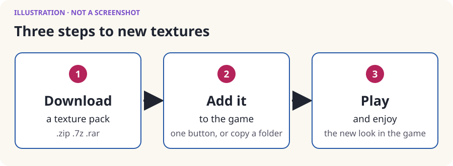
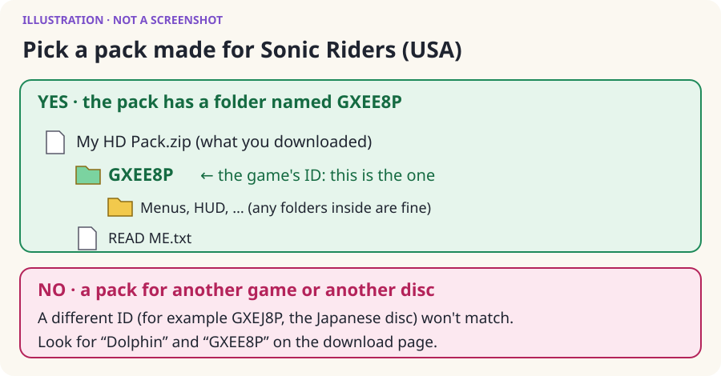
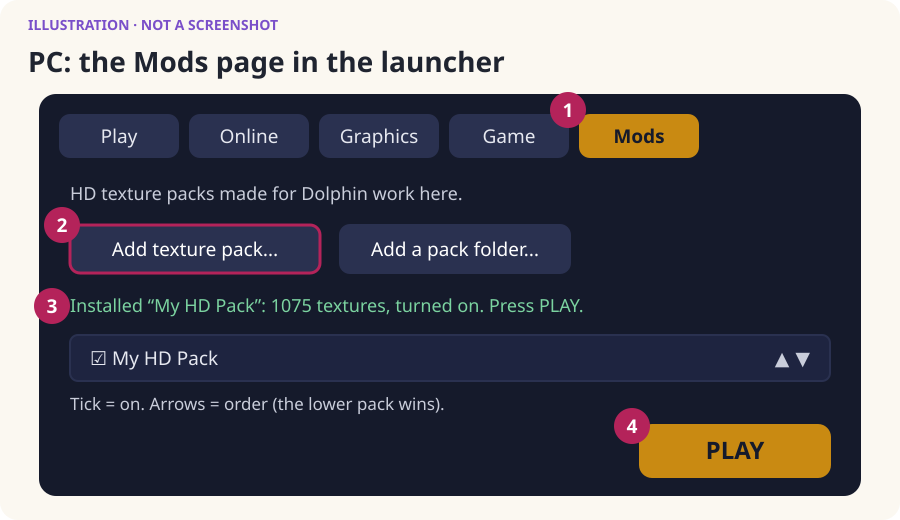
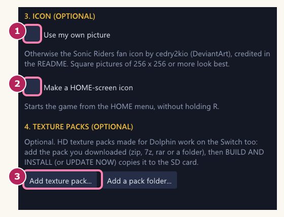
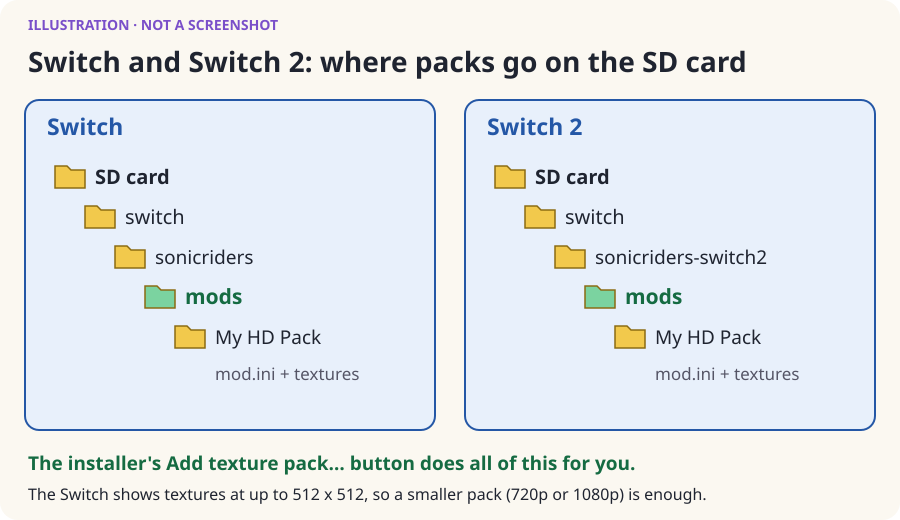
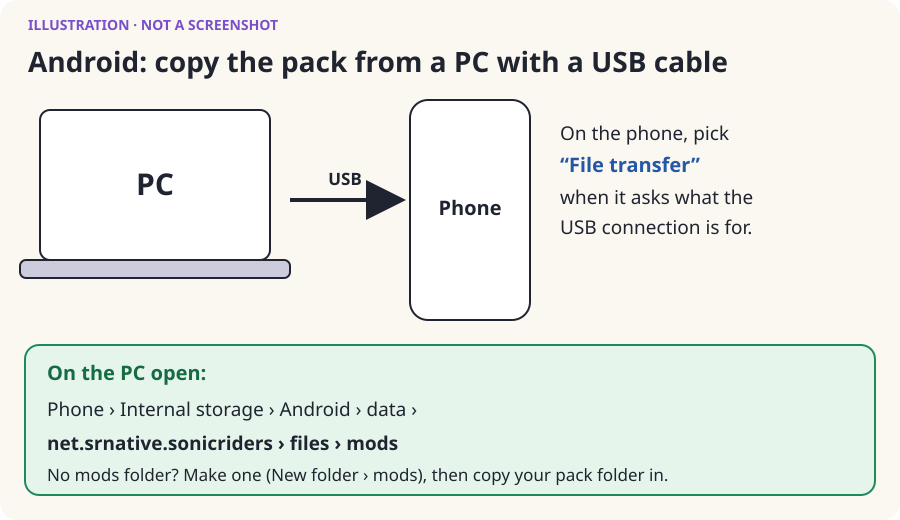
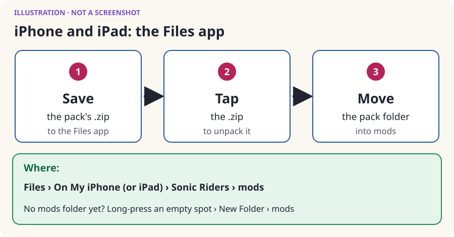
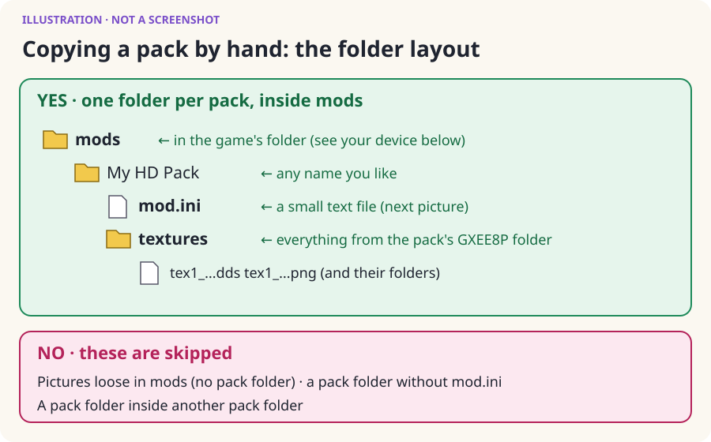
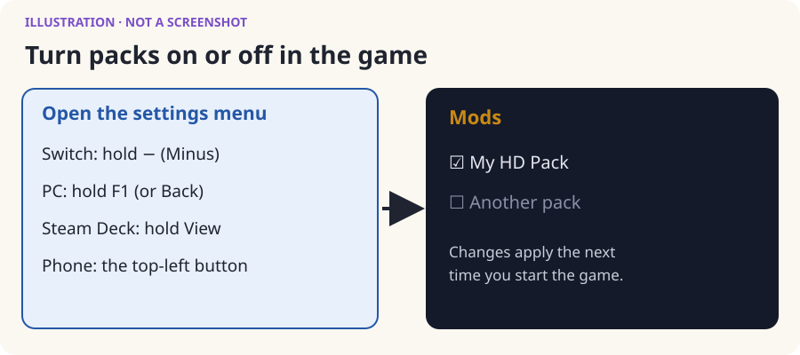

# HD texture packs: the easy guide

Texture packs give the game sharper, redrawn pictures: menus, characters, boards, tracks. Packs made for the
**Dolphin** emulator work here as they are. You download the pack yourself (we don't host packs).



**Jump to your device:** [PC (Windows)](#pc-windows) · [Switch](#switch) ·
[Switch 2](#switch-2) · [Android](#android) · [iPhone and iPad](#iphone-and-ipad) ·
[Linux and Steam Deck](#linux-and-steam-deck) · [Turn packs on or off](#turn-packs-on-or-off) ·
[Something's wrong?](#somethings-wrong)

---

## Before you start: pick the right pack



1. The pack must be made for **Sonic Riders (USA)**. Its files sit in a folder named **`GXEE8P`** (the game's
   ID). The download page usually says "Dolphin" and "GXEE8P".
2. `.zip`, `.7z` and `.rar` downloads are all fine. So is an already unpacked folder.
3. The pictures inside can be `.png` or `.dds`, upper or lower case.
4. Packs often come in several sizes (720p, 1440p, 4K). **On a Switch, pick the smallest one**: the Switch
   shows textures at up to 512 x 512 anyway, and smaller packs load faster.

---

## PC (Windows)

The launcher does everything for you.



1. Open the **Sonic Riders** launcher (the shortcut you use to play).
2. Click **Mods** at the top.
3. Click **Add texture pack...** and pick the `.zip`, `.7z` or `.rar` you downloaded.
   (Already unpacked it? Use **Add a pack folder...** instead.)
4. Wait until it says **Installed "...": N textures, turned on.**
5. Press **PLAY**. That's it.

<details>
<summary>Prefer to copy it yourself?</summary>

Put the pack in the `mods` folder inside your game folder (for example `C:\Games\SonicRiders\mods`). The layout
is in [Copying a pack by hand](#copying-a-pack-by-hand) below.

</details>

---

## Switch

The installer you used to put the game on the console copies the pack to the SD card for you.



1. Put the Switch's SD card in your PC.
2. Open **Install Sonic Riders (Switch).exe**.
3. Under **4. TEXTURE PACKS (OPTIONAL)**, click **Add texture pack...** and pick the pack you downloaded
   (or **Add a pack folder...** for an unpacked one).
4. Click **BUILD AND INSTALL** (or **UPDATE NOW** if the game is already installed).
5. Put the SD card back in the Switch and play.

<details>
<summary>Prefer to copy it yourself?</summary>

On the SD card open `switch` → `sonicriders` → `mods` (make `mods` if it isn't there) and put your pack folder
in it, laid out as in [Copying a pack by hand](#copying-a-pack-by-hand).

</details>

> The first time a new HD texture shows up, the game may pause for a moment while it loads. After that it's smooth.

---

## Switch 2

The Switch 2 alpha installer has **no** texture-pack button yet, so on Switch 2 you copy the pack by hand.



1. On your PC, **unpack** the download (right-click → **Extract All**). Find the `GXEE8P` folder inside.
2. Make the pack folder as shown in [Copying a pack by hand](#copying-a-pack-by-hand)
   (a folder with `mod.ini` and `textures` in it).
3. Turn the Switch 2 off and put its SD card in your PC.
4. On the SD card open `switch` → `sonicriders-switch2`. Make a folder named `mods` there if it isn't there yet.
5. Copy your pack folder into `mods`. A big pack can take a few minutes.
6. Put the SD card back, turn the console on and play.

Pick the pack's **smallest size**: big 4K packs only take longer to load and use more of the card.

---

## Android

Copy the pack from a PC with a USB cable.



1. On the PC, **unpack** the download (right-click → **Extract All**). Find the `GXEE8P` folder inside.
2. Make the pack folder on the PC as shown in [Copying a pack by hand](#copying-a-pack-by-hand)
   (a folder with `mod.ini` and `textures` in it).
3. Connect the phone with a USB cable. On the phone, choose **File transfer** when it asks.
4. On the PC, open **Phone** → **Internal storage** → **Android** → **data** → **net.srnative.sonicriders** →
   **files**.
5. Open `mods` (make a folder with that name if it isn't there) and copy your pack folder in.
6. Close the game fully and open it again.

---

## iPhone and iPad

Everything happens in the **Files** app.



1. Download the pack and choose **Save to Files** (or save it on a Mac and AirDrop it).
2. In **Files**, tap the `.zip` once: it unpacks into a folder. (`.7z` and `.rar` need a free unpacking app, or
   unpack them on a computer first.)
3. Open **On My iPhone** (or **On My iPad**) → **Sonic Riders**. If there's no `mods` folder, long-press an
   empty spot → **New Folder** → name it `mods`.
4. Make the pack folder as shown in [Copying a pack by hand](#copying-a-pack-by-hand). The `mod.ini` file is
   easiest to make on a computer; you can also save it from the **Notes** app via **Share** → **Save to Files**
   and rename it to `mod.ini`.
5. Move the pack folder into `mods`. Close the game fully and open it again.

---

## Linux and Steam Deck

1. Unpack the download (right-click → **Extract**). Find the `GXEE8P` folder inside.
2. Open the folder you installed the game in (the one with `Sonic Riders.sh`), then its `mods` folder (make it if
   it isn't there).
3. Put the pack folder in it as shown in [Copying a pack by hand](#copying-a-pack-by-hand).

On a Steam Deck do this in **Desktop Mode** with the **Dolphin** file manager, then go back to Game Mode.

---

## Copying a pack by hand

Only needed if you're not using a button above. Every device uses the same layout.



1. Inside `mods`, make a folder for the pack. Any name works, for example `My HD Pack`.
2. Inside it, make a folder named `textures`.
3. Open the pack's `GXEE8P` folder, select **everything** in it and copy it into `textures`.
4. Next to `textures`, make a text file named `mod.ini` with these three lines:

![mod.ini: the lines [mod], name = My HD Pack, game = GXEE8P. Save as mod.ini, not mod.ini.txt.](images/texture-packs/mod-ini.svg)

```ini
[mod]
name = My HD Pack
game = GXEE8P
```

On Windows: open **Notepad**, paste the lines, **File** → **Save as**, set *Save as type* to **All files** and
type `mod.ini`. (If Windows hides file endings, a file that shows as `mod.ini` might really be `mod.ini.txt`.)

---

## Turn packs on or off



1. Open the settings menu in the game: **Switch:** hold **−** (Minus) · **PC:** hold **F1** (or the pad's
   **Back**) · **Steam Deck:** hold **View** · **Phone:** the top-left button.
2. Go to **Mods** and tick or untick the pack.
3. Restart the game: changes apply the next time it starts.

Two packs that change the same picture: the one **lower** in the list wins. On PC you can change the order
with the arrows on the launcher's **Mods** page.

To **remove** a pack for good, delete its folder from `mods`.

---

## Something's wrong?

| What you see | What to do |
|---|---|
| The game looks the same | Check the pack is for **GXEE8P**, it's **ticked** in Mods, and you **restarted** the game. |
| Some pictures changed, some didn't | Normal for many packs: they only redraw part of the game. Or two packs overlap (see the order above). |
| "No textures found: this doesn't look like a Dolphin texture pack." | The download isn't a Dolphin pack for this game: look for one with a `GXEE8P` folder. |
| "Couldn't unpack it." | Unpack the download yourself, then use **Add a pack folder...** |
| A pack you copied by hand isn't in the Mods list | `mod.ini` is missing, or it's really named `mod.ini.txt`. |
| Short pauses on the Switch the first time a texture shows | Expected. Use the pack's smallest size; it gets better as you play. |
| A pack looks a bit off on water or effects | Some effects stretch a picture; HD replacements can look slightly different there. |

Still stuck? Open an issue with the game's `sonicriders.log` (it's in the game folder). Look for lines starting
with `[texpack]`: they say how many textures were found.

Making your own pack, and the technical details: [MODDING.md](MODDING.md#texture-packs).
