# Sonic Riders Recomp — Nintendo Switch 2

## Experimental Alpha Release

Checked for **Alpha 2 · v0.8.7-switch2-alpha.2** on November 18, 2026.

This is an early test version. Bugs can interrupt play. Read the audio warning below before you begin.

[Illustrated HTML booklet](install-switch2.html) · [Choose your console](index.md) · [Nintendo Switch — Stable](install-switch.md)

Tick the checkpoints as you go. Pictures have text descriptions.

**Please read first:** Alpha 2 can develop severe, lasting audio distortion in Race Select, sometimes after a freeze. Switching Unlimited off or leaving the menu did not fix the reported session. This is unresolved. If you want a trouble-free first homebrew project, wait for a more mature native release.

## Installation steps

1. [Before you start](#ready)
2. [Prepare your game image](#disc)
3. [Download the correct setup package](#download)
4. [Extract the ZIP file](#extract)
5. [Connect the SD card](#card)
6. [Open the installer](#open)
7. [Select your game image](#choose-disc)
8. [Select the SD card](#choose-card)
9. [Configure installation options](#options)
10. [Build and install](#build)
11. [Open the output folder](#output)
12. [Copy the files manually](#manual)
13. [Verify the SD card folder structure](#folders)
14. [Safely eject the SD card](#eject)
15. [Launch Sonic Riders](#launch)
16. [Verify the installed version](#play)
17. [Update without losing your progress](#update)

[Help](#help) · [Report a bug](#report)

<a id="ready"></a>

## 01. Before you start

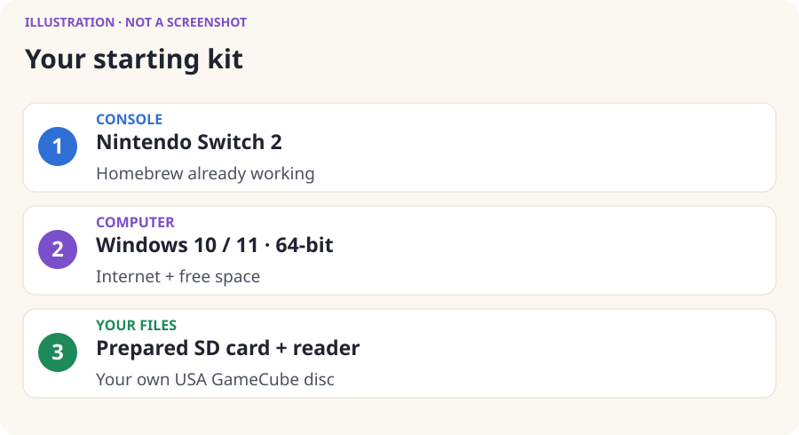

*Illustration, not a screenshot.*

1. Check the console’s name. This booklet is for **Nintendo Switch 2**. If your console is an original Switch, Switch Lite, or Switch OLED, use the other booklet.
2. Check that homebrew already works: A compatible **native homebrew** setup. Native means made for Switch 2. It must already open the native Homebrew Menu.
3. If homebrew is new to you, start with [kaiHEN’s official instructions](https://github.com/ouncebrew/kaihen#starting-it). Finish that setup before coming back here. The Sonic Riders installer does not set up homebrew.
4. The recorded console test used **firmware 23.0.1, kaiHEN 20261117.1 through Seedsow, and OunceShell**. This is one tested setup, not a promise for every console. The [Seedsow project’s setup instructions](https://github.com/Malev0/seedsow-fs-kaihen#setup-once) describe that entry route and its extra requirements. Do not update firmware just to match these numbers. Check those projects’ current compatibility instructions.
5. Use a **64-bit Windows 10 (1803 or newer) or Windows 11 computer**. Connect it to the internet. Windows 11 is recommended. A Mac, phone, or Chromebook cannot run this Windows installer.
6. Make at least **8 GB of free space** on the computer. Extra room is helpful if your disc needs converting.
7. Have the **SD card already used by your working Switch 2 homebrew setup**. Leave at least **2 GB free**, plus room for any texture packs. Have a reader that can read that card, including microSD Express if that is what your setup uses.
8. Have your own **Sonic Riders for GameCube, USA, revision 0** disc image. The next page explains this file.
9. Keep the computer awake and plugged in while it builds. Allow **10–40 minutes** for a first install. Download speed and computer speed can change this time.

> A homebrew menu is a list of community-made apps. If you cannot open it yet, finish the linked homebrew setup first. Do not format a card that already has your files on it.

- [ ] **Checkpoint:** You have a working homebrew menu, a Windows computer, free space, and your own game image.

<a id="disc"></a>

## 02. Prepare your game image

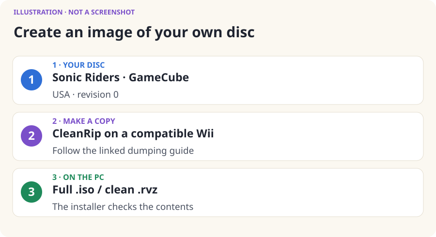

*Illustration, not a screenshot.*

1. Find your own **USA GameCube Sonic Riders** disc. This is the original Sonic Riders, not Sonic Riders: Zero Gravity.
2. A **disc image** is one file holding a copy of a disc. A full image usually ends in `.iso`. Copying a disc to this file is called **dumping**.
3. If you need to dump it, open the [illustrated Wii dumping walkthrough](https://wii.hacks.guide/dump-games.html#dumping-a-disc-to-sd-usb-cleanrip). It uses **CleanRip**, a disc-copying homebrew app. Follow its **GameCube** section. You need a Wii that can read GameCube discs and a working Homebrew Channel. The Wii mini, ordinary Wii Family Edition, and Wii U’s Wii mode cannot read these discs.
4. Let CleanRip finish. Copy the resulting full `.iso` from its storage device to a folder on your computer. Keep the original file safe. Follow the dumping guide’s file-joining instructions if your dump is split into parts.
5. Already have a dump? You can select a clean `.iso` or `.gcm`. A clean Dolphin `.rvz` or `.wia` also works. The installer converts it to `.iso` for you. Your original file stays unchanged.
6. Use a clean, full copy. European, Japanese, modified, trimmed, incomplete, GCZ, and CISO images are not accepted. An RVZ made with **Remove Junk Data** is not a full copy. Renaming a file cannot turn it into the right game.

> The installer contains no game. Use your own disc and follow the rules where you live. We do not provide game downloads.

**For helpers:** accepted disc ID `GXEE8P`, revision `0`; full ISO size `1,459,978,240 bytes`; SHA-1 `ce0cecf57034bef8bab7d6f588ce92c85a849613`. The installer checks this fingerprint automatically. A filename alone does not prove that a dump is supported.

- [ ] **Checkpoint:** Your own full game image is on the computer. You know where you saved it.

<a id="download"></a>

## 03. Download the correct setup package

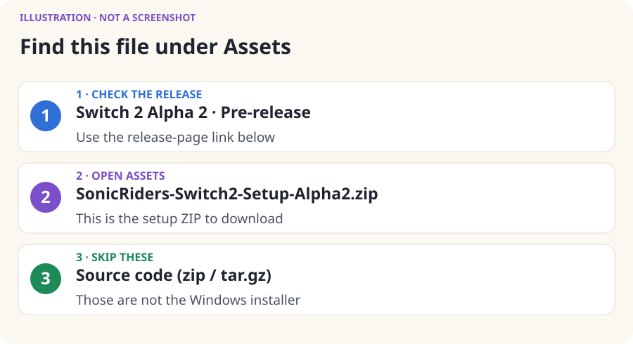

*Illustration, not a screenshot.*

1. Open the [Nintendo Switch 2 release page](https://github.com/teclilla18/sonic-riders-recomp/releases/tag/v0.8.7-switch2-alpha.2). GitHub is the website that holds this project’s downloads. You can read the page and download without an account.
2. Check the heading. This page should say **Switch 2 Alpha 2**. The **Pre-release** label is expected. Alpha means it is still being tested.
3. Scroll down to **Assets**. Assets means the downloadable files. If the list is folded up, click **Assets** to open it.
4. Click **`SonicRiders-Switch2-Setup-Alpha2.zip`**. You can also use the big download button below.
5. Wait for the download to finish. Do not choose **Source code (zip)** or **Source code (tar.gz)**. Those are for developers and do not contain the ready-to-use Windows installer.

**[Download SonicRiders-Switch2-Setup-Alpha2.zip](https://github.com/teclilla18/sonic-riders-recomp/releases/download/v0.8.7-switch2-alpha.2/SonicRiders-Switch2-Setup-Alpha2.zip)**

> Keep this alpha package separate from stable downloads. Its updates are manual.

- [ ] **Checkpoint:** The downloaded filename is exactly `SonicRiders-Switch2-Setup-Alpha2.zip`.

<a id="extract"></a>

## 04. Extract the ZIP file

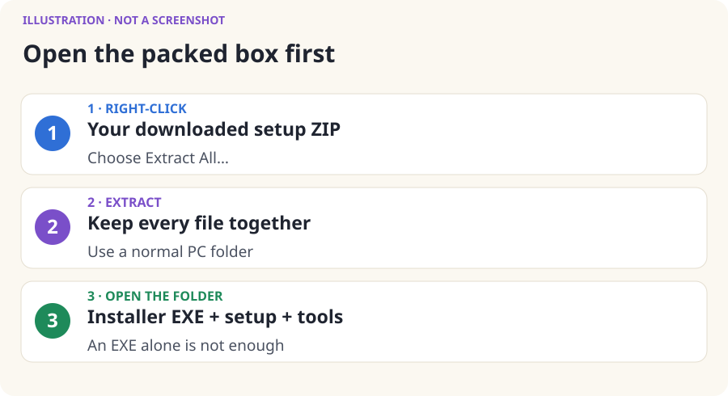

*Illustration, not a screenshot.*

1. Open **File Explorer**. It is the yellow folder app on the Windows taskbar, at the bottom of the screen.
2. Click **Downloads** in the left column. Find `SonicRiders-Switch2-Setup-Alpha2.zip`. If you chose a different download location, open that folder instead.
3. Click the ZIP with the **right mouse button**. Choose **Extract All…**. A ZIP stores several files in one file. Extracting restores those files to a normal folder.
4. In the extraction window, choose a short place you can find again, such as `C:\SonicRidersAlpha`. Use English letters and numbers in the path. Spaces work, but accented characters in the path can stop the tools.
5. Click **Extract**. Wait until it finishes. Keep all the extracted files together.
6. Open the extracted folder. Open `SonicRiders-Switch2-Alpha2` if there is one more folder inside. Stop when you can see `Install Sonic Riders (Switch2).exe`, `setup`, and `tools` together.

> Do not double-click the installer while browsing inside the ZIP. Copying only the EXE is not enough. [Windows extraction help](https://support.microsoft.com/en-us/windows/experience/storage-filemanagement/zip-and-unzip-files).

- [ ] **Checkpoint:** You see `Install Sonic Riders (Switch2).exe` beside the `setup` and `tools` folders. The address at the top does not end in `.zip`.

<a id="card"></a>

## 05. Connect the SD card

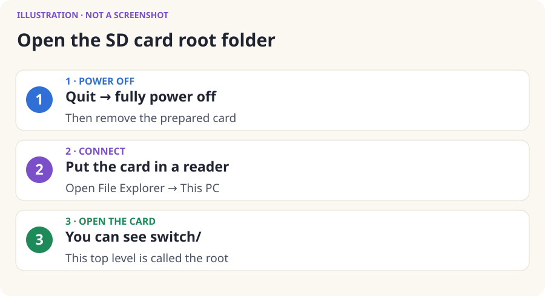

*Illustration, not a screenshot.*

1. Quit any running game. Power the console fully off using its power menu. Sleep mode is not power off. Follow your homebrew setup’s shutdown instructions.
2. Remove the prepared SD card. Put it in your computer’s card reader. If your computer has no matching slot, use a suitable USB reader.
3. Open File Explorer. Click **This PC** in the left column. Look for the card under **Devices and drives**. A drive is a storage device shown by Windows.
4. Open the card. Its **root** means its very top folder. You should be looking at the existing `switch` folder, alongside your other homebrew files. Do not open `switch` yet.
5. If a working homebrew card has no `switch` folder yet, make one at this top level: right-click an empty space, choose **New → Folder**, and type exactly `switch`. Leave the other folders alone.
6. If Windows asks you to format the card, click **Cancel**. Formatting erases files. Check that the reader supports the card and that it is the right card.

> This booklet uses a card reader. An existing native OunceShell transfer setup is an advanced alternative. It is not needed for this route.

- [ ] **Checkpoint:** Windows can show the existing homebrew files on your card. You have not formatted or erased it.

<a id="open"></a>

## 06. Open the installer

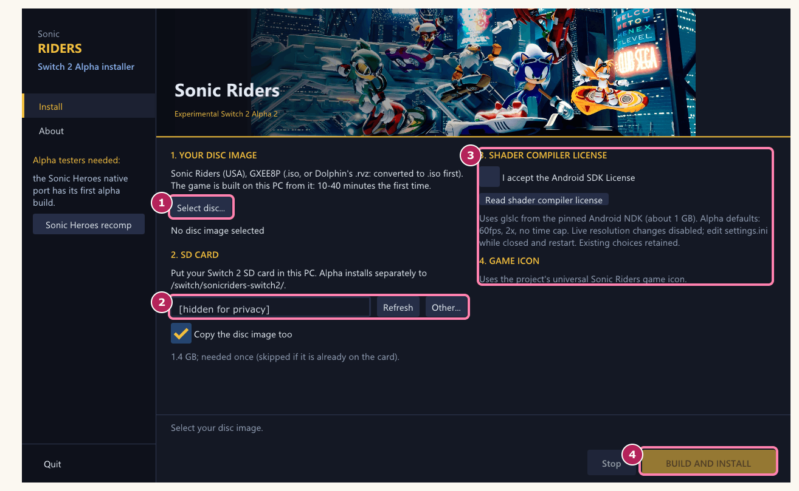

*Actual screenshot with annotations.*

1. Go back to the normal folder you extracted on your computer.
2. Double-click **`Install Sonic Riders (Switch2).exe`**. Double-click means press the left mouse button twice quickly.
3. Windows may hide the `.exe` ending. In that case, look for the same name with **Application** in the Type column. Do not open the command-line BAT file for this illustrated guide.
4. Check the installer window. It should identify **Switch 2 Alpha installer**.
5. If Windows blocks the program, first check that the ZIP came from the exact project release linked above. This installer is unsigned. If you cannot verify the download, stop and ask someone you trust to help. Do not turn off Windows security.

> The colorful picture across the top is part of the real installer. Your window may be a different size. You can make it larger by clicking the square at the top right.

- [ ] **Checkpoint:** The Nintendo Switch 2 installer is open. You are still on the computer.

<a id="choose-disc"></a>

## 07. Select your game image

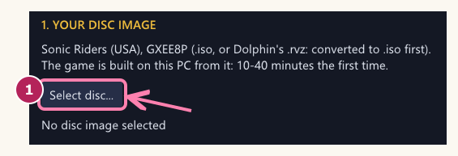

*Actual screenshot with annotations.*

1. Click the pink-marked **Select disc…** button shown in the picture.
2. In the file window, open the folder where you saved your own game dump. Single-click the `.iso`, `.gcm`, `.rvz`, or `.wia` file.
3. Click **Open**. This selects the file for the installer. You do not need to double-click or mount an ISO in Windows.
4. Look below **Select disc…**. Your selected file’s name should now appear. The installer performs the full game checks when you start the build.

- [ ] **Checkpoint:** The installer shows the game image you chose. It no longer says “No disc image selected”.

<a id="choose-card"></a>

## 08. Select the SD card

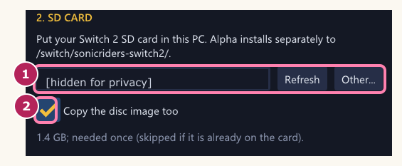

*Actual screenshot with annotations.*

1. Find **2. SD CARD** in the installer.
2. Click **Refresh** if you inserted the card after opening the installer.
3. Click the small downward arrow on the SD card box. Choose your card if it is listed.
4. If your card is missing from that list, click **Other…**. In the folder picker, choose **This PC**, then your SD card’s top folder. Click the folder picker’s confirmation button. Do not choose the folder holding the installer.
5. Check that the card you picked is the same card you opened in the previous page. For a first install, keep **Copy the disc image too** ticked. This puts the game’s data beside the program.
6. If you want to copy files later, choose **Keep SD-ready files on this PC** instead. This makes files on the computer only. Use the manual-copy page below afterward.

> Automatic detection is only a suggestion. Always check the card yourself. A missing card in the list does not mean you need to format it.

- [ ] **Checkpoint:** For the easy route, the installer shows your SD destination and “Copy the disc image too” is ticked.

<a id="options"></a>

## 09. Configure installation options

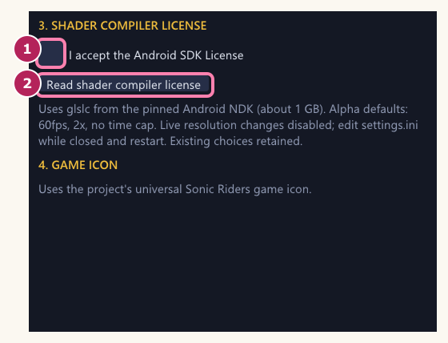

*Actual screenshot with annotations.*

1. Find **3. SHADER COMPILER LICENSE**. Click **Read shader compiler license**. Read the terms before deciding.
2. If you agree, tick **I accept the Android SDK License**. This is needed for a tool that prepares the graphics. It does not install an Android game on your console.
3. The compiler download is about **1 GB**, in addition to other tools. Leave the computer online.
4. **4. GAME ICON** uses the project’s game icon. There is no icon file to choose here.

> Fresh installs use 2x internal resolution, normal 60 FPS and no automatic exit timer. Leave the default settings alone for the first launch. Unlimited rendering is experimental. Changing resolution while the game is running is disabled in this alpha.

- [ ] **Checkpoint:** The required options are selected. Optional extras are not needed for the first installation.

<a id="build"></a>

## 10. Build and install

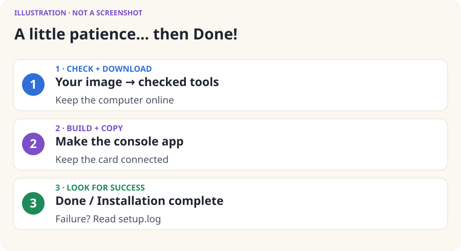

*Illustration, not a screenshot.*

1. Click **BUILD AND INSTALL** at the bottom right. If it is dimmed, read the message at the bottom. It tells you which required choice is missing.
2. Leave the installer open. It checks your image, downloads its tools, and builds the program from your own disc. **Build** means make the program that your console can run.
3. Watch the progress messages. Some steps take several minutes. A changing log is a sign that it is working. Keep the internet connected and the SD card plugged in.
4. Do not press **Stop** unless you want to cancel. Do not close the window, unplug the card, or put the computer to sleep while files are being written.
5. Wait for **Done** or **INSTALLATION COMPLETE**. If you see **INSTALL FAILED**, go to the help section. Having a folder named `build` does not by itself mean the build succeeded.

> You do not need to install Python, Visual Studio, devkitPro or another development kit yourself. The installer fetches its own checked tools.

- [ ] **Checkpoint:** The installer says the installation completed. There is no failure message.

<a id="output"></a>

## 11. Open the output folder

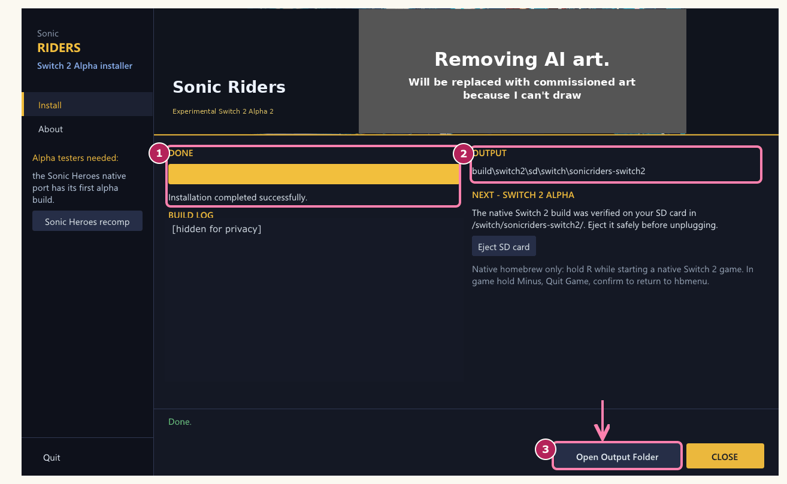

*Actual screenshot with annotations.*

1. After success, click **Open Output Folder** in the bottom action bar. The button stays there when you resize the window.
2. File Explorer opens a folder **on your computer**: `build/switch2/sd/switch/sonicriders-switch2/`. It opens this local folder even if you already disconnected the SD card.
3. Look for `sonicriders-switch2.nro`, `build-info.json`, `env.txt`, and `settings.ini`. The `.nro` is the console app. The JSON file identifies the matching build. The two text files hold startup defaults and settings.
4. If the installer already copied to the correct SD card and reported success, continue to **Verify the SD card folder structure**. Opening this folder does not copy anything by itself.

> The local output folder is not your SD card. If you chose to keep the build on the PC, you still need the next page.

- [ ] **Checkpoint:** The local folder contains the native NRO and its matching build-info.json.

<a id="manual"></a>

## 12. Copy the files manually

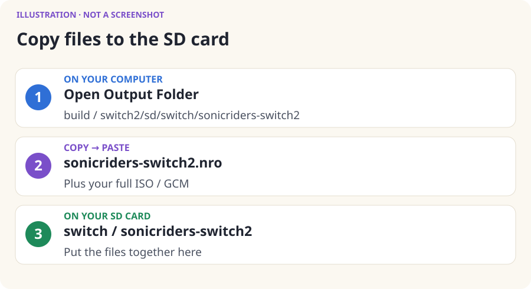

*Illustration, not a screenshot.*

1. Use this page only if the installer did not copy to your SD card. Keep the installer’s successful output folder open.
2. Open a second File Explorer window. Open **This PC**, then your SD card.
3. Open the card’s `switch` folder. If `sonicriders-switch2` is missing inside it, right-click an empty space, choose **New → Folder**, and name it exactly `sonicriders-switch2`.
4. In the local output folder, select `sonicriders-switch2.nro`, `build-info.json`, `env.txt`, and `settings.ini` for a **fresh** install. Hold **Ctrl** while clicking each file. Press **Ctrl+C** to copy.
5. Open `/switch/sonicriders-switch2/` on the card. Press **Ctrl+V** to paste. Wait for the copy to finish.
6. Copy your own **full ISO or GCM** into that same folder. An RVZ or WIA cannot be used directly on the console. If the installer converted one, use the generated `.iso` from the extracted installer’s `baserom` folder.
7. Keep just one supported game image in this game folder. Its name may differ from the example. It must really end in `.iso` or `.gcm`, not `.rvz`, `.zip`, or `.iso.iso`.

> For an existing install, copy only the new NRO and matching build-info.json. Keep the SD card’s own env.txt and settings.ini. The SD-ready folder does not include your disc image.

- [ ] **Checkpoint:** The app and your full disc image sit together inside `/switch/sonicriders-switch2/`.

<a id="folders"></a>

## 13. Verify the SD card folder structure

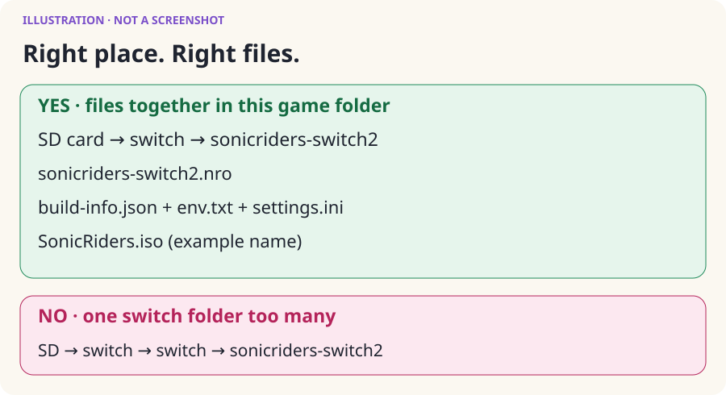

*Illustration, not a screenshot.*

1. On the card, open `switch`, then `sonicriders-switch2`. Compare it with the picture below.
2. Check the exact app name: **`sonicriders-switch2.nro`**. Do not rename another platform’s app to this name.
3. Check that your own full `.iso` or `.gcm` is in the **same folder** as the NRO. The example uses `SonicRiders.iso`; the installer keeps your ISO’s original name.
4. If Windows hides file endings, use **View → Show → File name extensions** on Windows 11. On Windows 10, open **View** and tick **File name extensions**. Now check that the app does not end in `.nro.nro`.
5. Leave your other homebrew folders alone. This picture shows only the part that matters to Sonic Riders.

### The files needed to start

```text
SD card (top folder)
└── switch/
    └── sonicriders-switch2/
        ├── sonicriders-switch2.nro
        ├── build-info.json
        ├── env.txt
        ├── settings.ini
        └── SonicRiders.iso   ← your full image; its name may differ
```

### After playing or adding packs

```text
/switch/sonicriders-switch2/
├── saves/             ← your game progress; keep this
├── settings.ini       ← your choices; keep this
├── mods/              ← texture packs/mods, if added; keep this
└── cache files        ← may appear after playing; keep these
```

- [ ] **Checkpoint:** The path is exactly `/switch/sonicriders-switch2/sonicriders-switch2.nro`, with the full image beside it.

<a id="eject"></a>

## 14. Safely eject the SD card

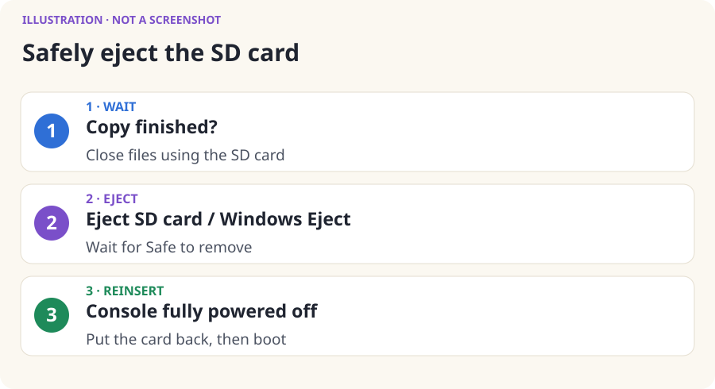

*Illustration, not a screenshot.*

1. Wait for all copy windows to finish. Close any files or Explorer windows using the card.
2. If the installer has your SD card selected, click **Eject SD card**. Wait for **Safe to remove the SD card now.**
3. Or use Windows: click the small **up arrow** near the clock at the bottom right. Right-click **Safely Remove Hardware and Eject Media**. Choose **Eject** for your card or reader.
4. Wait for Windows to say the hardware can be removed. If it says the card is in use, close the program using it and try again. Do not pull it out during a copy.
5. Take the card out of the reader. With the console fully powered off, put the card back in it. Start your usual working homebrew setup.

> [Microsoft’s illustrated safe-removal help](https://support.microsoft.com/en-us/windows/hardware/safely-remove-hardware-in-windows). If you used a native file-transfer app instead, finish its transfer and disconnect using that app’s instructions.

- [ ] **Checkpoint:** The card is back in the console after a safe eject.

<a id="launch"></a>

## 15. Launch Sonic Riders

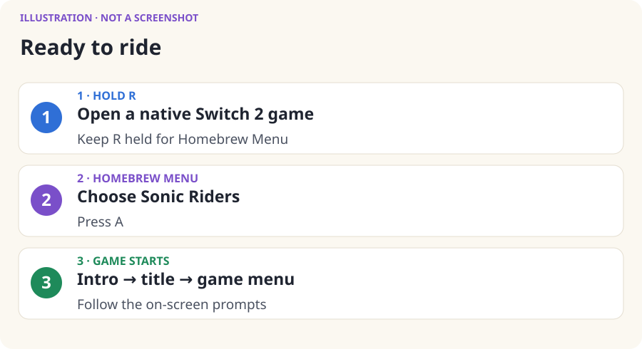

*Illustration, not a screenshot.*

1. Start your already-configured **native Switch 2** homebrew environment.
2. On HOME, highlight a **native Switch 2 game** that your loader supports. Hold the controller’s **R shoulder button** while opening it. Keep holding R until the native Homebrew Menu opens.
3. Follow the current loader instructions if the first launch still opens the game. kaiHEN’s instructions say the second launch and later open hbmenu. Close the native game normally and repeat the hold-R launch when instructed.
4. In Homebrew Menu, use the stick or D-pad to highlight **Sonic Riders**. Press **A**.
5. Wait for the game to start. You should reach the intro or title screen. Follow the game’s on-screen prompts. It may ask to create a memory-card save on the first run.
6. When you reach the main menu, you have completed the install. Try a short race before adding optional packs or changing many settings.

> This alpha has no native HOME-screen forwarder. The loader determines how hbmenu opens; the native-game hold-R route is the one recorded in the project’s console testing.

- [ ] **Checkpoint:** Sonic Riders reaches its title screen and menu. A successful PC build alone is not this checkpoint.

<a id="play"></a>

## 16. Verify the installed version

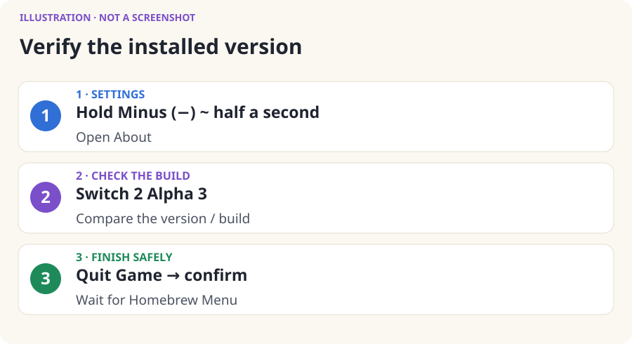

*Illustration, not a screenshot.*

1. In the game, hold **Minus (−)** for about half a second. This opens the port’s settings menu.
2. Open **About**. Check the version/build information against **Alpha 2 · v0.8.7-switch2-alpha.2**. If an old version is still shown, follow **Update without losing your progress** below.
3. Keep normal **60 FPS** selected for a first test. **Unlimited rendering** is experimental. The number 60 is a target, not a guarantee for every scene or setup.
4. To quit normally, open the Minus menu, choose **Quit Game**, and confirm. Wait to return to Homebrew Menu. Do not remove the SD card while the game is saving.

- [ ] **Checkpoint:** The version/build is the one you installed. You can open settings and quit normally.

<a id="update"></a>

## 17. Update without losing your progress

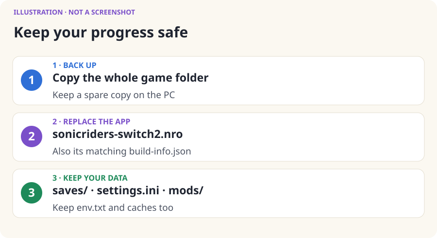

*Illustration, not a screenshot.*

1. Quit Sonic Riders normally before you update. Connect the SD card to your computer using the same safe steps as before.
2. **Back up first.** Copy the whole `/switch/sonicriders-switch2/` folder from the SD card to a safe folder on your computer. A backup is a spare copy. Keep it until you know the update works.
3. Open the [Nintendo Switch 2 release page](https://github.com/teclilla18/sonic-riders-recomp/releases/tag/v0.8.7-switch2-alpha.2). For a future update, check for a newer release for **this same platform**. Download its matching setup ZIP.
4. Extract the new ZIP to a **new normal folder** on the PC. Open its installer. Select your same own game image and the same SD card root.
5. Build and install. Keep the existing full game image if it is already verified on the card; **Copy the disc image too** can be unticked for that case.
6. For a manual update, copy **only** the new `sonicriders-switch2.nro` and its matching `build-info.json` into the existing game folder. Replace that pair together. Do not overwrite your SD card’s `env.txt` or `settings.ini` with fresh defaults.
7. Keep `saves/`, `settings.ini`, `mods/`, `env.txt` if present, and cache files. Your texture packs live under `mods/`. Do not delete the old game folder or replace it with an empty folder.
8. Eject safely. Launch again. Open **Minus → About** to check the version/build. Also check that your save and chosen settings are still there.

> Alpha updates are manual. Do not use the stable automatic updater for this native target. To roll back, restore your backed-up NRO and its matching build-info.json together; retain your user data.

- [ ] **Checkpoint:** The new version/build appears, and your progress, settings and packs are still present.

<a id="help"></a>

## Picture-by-picture help

### My download does not contain the right installer

Check the full ZIP name: `SonicRiders-Switch2-Setup-Alpha2.zip`. Open the release page and choose that asset. **Source code (zip)** is not the setup package. Keep all extracted files together.

[Picture and steps](#download).

### The installer cannot find setup files

Close it. Right-click the original ZIP and choose **Extract All…**. Open the normal extracted folder. The EXE, `setup`, and `tools` must be together. Do not run a lone EXE copied out of the ZIP.

[Picture and steps](#extract).

### It says the game image is wrong

Read the exact message. Only the clean USA GameCube disc, revision 0, is supported. Select the full correct dump. For a checksum or incomplete-copy error, dump your own disc again using CleanRip’s checks. A different filename cannot fix different contents. RVZ/WIA must preserve the original disc data. See the full-image fingerprint on the disc page.

[Picture and steps](#disc).

### The app or disc file is missing

Wait for a successful build first. Open the output folder and copy `sonicriders-switch2.nro` to `/switch/sonicriders-switch2/`. Put your full ISO/GCM beside it. Show file name extensions to catch `.nro.nro` or `.iso.iso`. RVZ stays on the PC; copy the converted ISO from `baserom` instead. Also copy the matching `build-info.json`.

[Picture and steps](#folders).

### My folders look different

The card needs `/switch/sonicriders-switch2/sonicriders-switch2.nro`. An extra `switch` inside `switch` is wrong. So is copying the Windows setup folder to the card. Open the correct destination and copy only the files shown in the finished-tree picture. Preserve the other apps already on the card.

[Picture and steps](#folders).

### Sonic Riders is not in Homebrew Menu

Check that you are using the correct platform’s working Homebrew Menu. Check for `sonicriders-switch2.nro` directly in `/switch/sonicriders-switch2/`. Eject safely after correcting the files, then reopen the menu. A ZIP or Windows EXE will not appear as a console app.

[Picture and steps](#launch).

### The SD card is not found

Check that File Explorer can open the card. In the installer, press **Refresh**, then try **Other…** and pick its top folder. If Windows asks to format it, cancel. Check the reader and your existing homebrew setup before continuing.

[Picture and steps](#card).

### The installer says INSTALL FAILED

Keep the window open and read the last error. Find `setup.log` beside the installer EXE. If it reports insufficient space, free the stated space. If it reports a download failure, restore your connection and retry. If it reports unsupported path characters, extract to the short English-letter PC folder shown earlier. If a hash check fails, do not bypass it. Save the log and report the error if retrying does not fix it.

[Picture and steps](#build).

### I get a black screen or a crash

Check the native Switch 2 package, native Homebrew Menu, full ISO/GCM, and exact folder first. Do not use the original Switch NRO or rename it. If those match, preserve the logs and report it. Alpha compatibility is limited; there is no verified universal black-screen fix.

[Picture and steps](#launch).

### Known problems that are still open

**Unresolved:** Race Select (Free Race / Time Attack / World Grand Prix) can develop severe persistent audio distortion, sometimes after a freeze. Turning Unlimited off and leaving the menu did not recover the reported session. Quitting and relaunching may help, but it is not a proven cure. Missing music/announcer audio, stutters and slow startup are also known alpha issues. Keep normal 60 FPS for the first test. Save logs before relaunching. Do not treat an audio problem as proof that you installed it incorrectly.

[Picture and steps](#play).

### About still shows the old version

Compare the new local NRO with the file in `/switch/sonicriders-switch2/`. Make sure you copied to the card you actually use. Follow the manual update route, then launch that app again and check **Minus → About**. Keep your backup and save. If the version remains old, report both the downloaded ZIP name and the displayed version. Do not assume this identifies the cause of issue #31.

[Picture and steps](#update).

<a id="report"></a>

## Report a problem

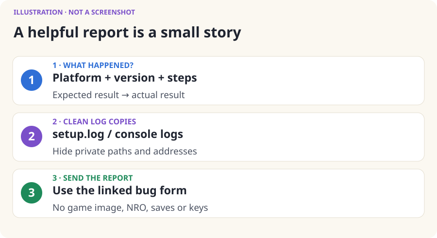

1. For an installer problem, open the normal extracted setup folder. Find **`setup.log`** beside the installer EXE. Open it in Notepad. Save a copy before retrying.
2. For a console problem, quit normally if possible. Before launching again, copy **`sonicriders.log`** and **`sonicriders.prev.log`**, if present, from `/switch/sonicriders-switch2/` to the computer. Also keep `lifecycle-*.log` files if present. The `*` stands for the different numbers in their names.
3. Read the copies before sharing. Replace personal paths, names, IP addresses or other private details with `[removed]`. Do not remove the error messages.
4. Open the [bug report form](https://github.com/teclilla18/sonic-riders-recomp/issues/new?template=bug_report.yml). A free GitHub account is needed to post a report. Reading guides and downloading do not need one.
5. Write **Nintendo Switch 2**, the ZIP filename, version/build shown in About, console model, firmware, homebrew loader/version, and exactly what you clicked or played. Say handheld or docked, stage, character, gear, player count, settings and any known clock settings. If you do not know a number, say “unknown”.
6. Add the error text and the cleaned log copies. Say what you expected, what happened, and whether you can make it happen again. A cropped photo of the error can help; hide private details.
7. Never attach your ISO/RVZ, NRO, saves, console keys, passwords, generated code or game assets. Those are not needed for a useful public report.

### Bug report template

```text
Platform: Nintendo Switch 2
Setup ZIP: SonicRiders-Switch2-Setup-Alpha2.zip
Version/build in About: …
Firmware and homebrew loader/version: …
Handheld or docked; known clocks: …
What I did, one step at a time: …
What I expected: …
What happened / exact error: …
Does it happen again? …
Cleaned log copies attached: …
```

## Sources and verification

The current published ZIPs were downloaded and hash-checked. Their installers were run on Windows into disposable SD folders; disc copies and updates were checked. The actual installer captures come from these published executables. Console steps use existing project hardware reports and the linked homebrew instructions. No console was reinstalled or play-tested for this booklet. Drawn console screens are clearly marked illustrations.

[Exact package hashes, sources and picture credits](guide-verification.md). The visual reference is the project’s existing Claude-made easy-read guides. Technical documentation remains in [INSTALL.md](INSTALL.md).
